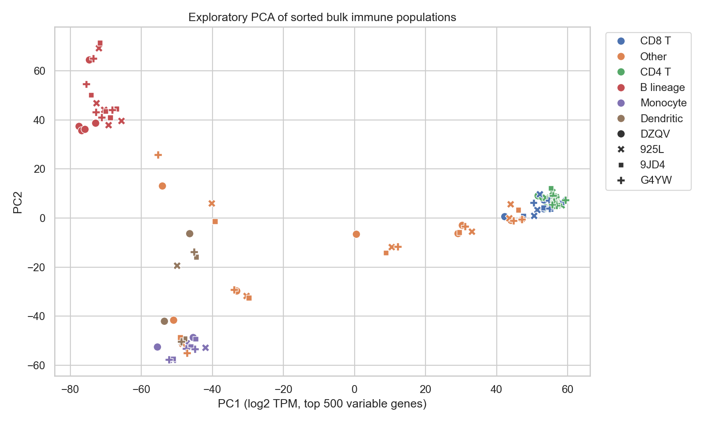

# RNA-seq Analysis: Donor-Held-Out Classification and Inference

A complete, auditable secondary analysis of public bulk RNA-seq data from GEO GSE107011.

**Question:** Can deposited expression profiles distinguish purified immune-cell populations in held-out donors, and what can four paired donors actually support statistically?

**Data:** Real public data from Monaco et al. (2019), not synthetic expression data. This project is a new secondary analysis of deposited TPM, not a reproduction of the complete original study.



## Analysis

1. Download GEO metadata, the deposited TPM matrix and a PubMed MEDLINE citation. Verify pinned SHA-256 hashes.
2. Align exact sample IDs; reject duplicate identities, mismatched sample sets, nonfinite or negative expression.
3. Report detected genes, total deposited TPM and cell-type/donor coverage. Exclude PBMC mixtures and cell types represented in fewer than three donors using metadata only.
4. Apply log2(TPM+1). Fit variance filtering, feature selection, scaling and logistic regression within each held-out-donor training fold.
5. Save sample predictions, fold assignments, per-fold scores, a dummy baseline, exploratory PCA and a confusion matrix.
6. Compare NK and naive B expression within four donors. Enumerate all 16 paired sign flips, correct across genes with Benjamini-Hochberg, and report effect sizes separately from statistical discoveries.
7. Repeat the donor-held-out evaluation 20 times with shuffled cell-type labels as a negative control, and compare it with a deliberately leaky pipeline that selects features on all samples before the split.

## Results

The source matrix contains 127 samples and 58,311 gene IDs. Metadata filtering retains 112 samples, 28 immune-cell types and four donors. Out-of-donor accuracy is 0.92857, macro F1 is 0.92379 and dummy accuracy is 0.03571. Fold accuracies range from 0.89286 to 0.96429. The separate three-fold random-sample comparator scores 0.67857. The exact two-sided paired p-value floor is 0.125; no gene has BH q < 0.05. Negative control: with the cell-type labels shuffled 20 times (class counts kept), the in-fold pipeline reaches a mean donor-held-out accuracy of 0.01071 (maximum 0.03571; chance is 0.03571). Choosing the 300 features on all samples before holding donors out, with the same shuffled labels, reaches a mean of 0.57098 (maximum 0.69643), which is the leak the in-fold design avoids.

## What the tests protect

Known-value and independent SciPy BH checks, independently enumerated paired p-values, zero differences, sign symmetry, bounded enumeration, invalid/empty inputs, shuffled ID alignment, duplicate/missing/negative/nonfinite expression and live source metadata identity. Offline suites on synthetic matrices also check that donor holdout never shares a donor and scores every sample once, that a leaking splitter is rejected, that real signal is recovered and the dummy baseline stays at the class prior, that shuffled labels fall to chance in-fold but not when selection comes first, that the permutation control is reproducible, metadata parsing and its rejections, and Benjamini-Hochberg and the exact paired test against independent formulations on random designs (the leakage guard is checked by disabling it).

## Libraries actually used

pandas and NumPy for expression/metadata alignment; SciPy for statistical checks; scikit-learn for fold-local classification and PCA; Matplotlib/seaborn for figures; Biopython for parsing and verifying the source publication MEDLINE record. This is bulk RNA-seq, so Scanpy is not used.

## Interpretation limits

Only four donors contribute to the classification and paired contrast. These are healthy purified cell populations, not mixed clinical specimens. There is no independent study, disease cohort, prospective test or clinical validation. PCA is descriptive and uses all included samples; it is not part of validation. Grouped and random splits have different training sizes and class coverage, so their score difference does not isolate a leakage effect. In this dataset the random split performs worse. No hyperparameter search was performed. scikit-learn emits a high-class-count warning in tiny folds; the labels are known categorical cell types, and the warning is retained in the executed notebook. Each donor contributes only one observation per retained cell type. Exact sign-flip inference requires appropriate sign exchangeability under the null. TPM contrasts are not raw-count differential expression; no DESeq2/edgeR claims are made. BH guarantees depend on the relevant null dependence assumptions, and the small exact-p floor prevents discoveries here regardless.

## Run it

Python 3.13 is the tested runtime. Dependencies, including notebook execution, are pinned in `requirements.lock` (version pins, not a hash-locked supply-chain guarantee).

```bash
python3.13 -m venv .venv
source .venv/bin/activate
python -m pip install -r requirements.lock
python scripts/validate.py
```

The validation command runs pytest, regenerates results and executes every notebook cell. Outputs go to ignored `artifacts/run/`. The executed notebook is saved separately so the source notebook stays clean. `reports/reference/` retains checked outputs and the validation receipt from the delivered revision.

```bash
# Equivalent isolated run, without local Python setup
docker build -t rnaseq-analysis:local .
docker run --rm --cpus=1 --memory=3g rnaseq-analysis:local
```

The container runs as an unprivileged user. GitHub Actions uses the same Python validation entrypoint. Initial public-data downloads require network access.

## Navigate

- [Source notebook](notebooks/analysis.ipynb) and [executed notebook](notebooks/analysis.executed.ipynb)
- [Implementation](analysis.py)
- [Tests](tests/test_analysis.py)
- [Actual findings and limitations](reports/reference/FINDINGS.md)
- [Machine-readable reference results](reports/reference/summary.json)
- [Analysis plan](docs/ANALYSIS_PLAN.json), a local design record rather than an externally registered protocol

## Authorship and use

Prepared for Kalif Shear's scientific Python portfolio with AI-assisted implementation. The code, tests and retained execution results are inspectable. These are new portfolio projects; synthetic and public-data provenance is disclosed above. Code is MIT licensed; any external source data remain subject to their own terms and attribution requirements.

## Public data provenance

Original data: Monaco G et al. (2019), *RNA-Seq Signatures Normalized by mRNA Abundance Allow Absolute Deconvolution of Human Immune Cell Types*, Cell Reports 26:1627–1640.e7. DOI: [10.1016/j.celrep.2019.01.041](https://doi.org/10.1016/j.celrep.2019.01.041).

- [GEO GSE107011](https://www.ncbi.nlm.nih.gov/geo/query/acc.cgi?acc=GSE107011)
- [Open-access paper](https://pmc.ncbi.nlm.nih.gov/articles/PMC6367568/)
- [Exact download URLs and SHA-256 checksums](data/sources.json)

Raw downloads are cached locally and excluded from Git. A changed source hash stops the pipeline for review. Downloaded MEDLINE metadata can change independently of expression data; updating it requires an explicit manifest revision. The original authors generated the experimental data and retain that credit. Published labels serve as reference annotations, not independently re-established biological truth.
